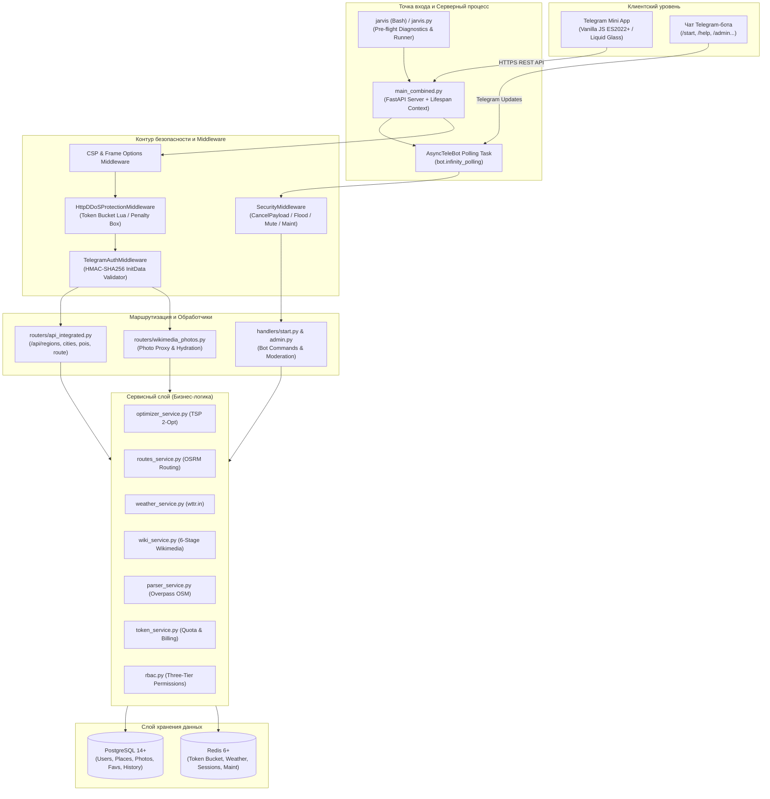
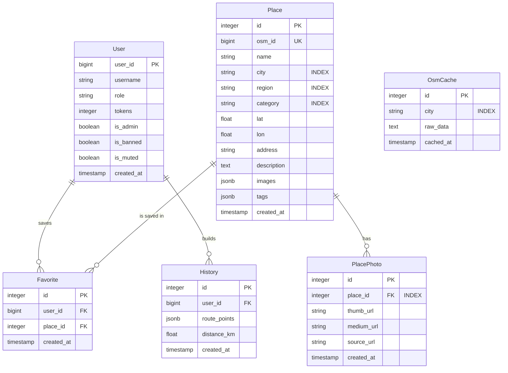

# JarvisGeoBot — Архитектурная и функциональная документация проекта (Developer Bible)

> **Версия системы:** Jarvis v2.4.0 (Stable Release)  
> **Стек технологий:** Python 3.10+ (FastAPI, AsyncTeleBot, SQLAlchemy 2.0 Async, Redis, Alembic) | Frontend (Vanilla JavaScript ES2022+, Modular CSS3 Liquid Glass, Telegram WebApp SDK) | Инфраструктура (PostgreSQL 14+, Redis 6+, OSRM, wttr.in, Wikimedia Commons API, Overpass OSM).  
> **Статус верификации:** 100/100 автоматизированных тестов пройдены успешно (`pytest src/tests -v`).  
> **Назначение документа:** Исчерпывающее техническое руководство, архитектурный эталон и единый источник правды (Single Source of Truth) для разработчиков, архитекторов и инженеров по эксплуатации.

---

## Оглавление

1. [Общая архитектура и модель выполнения](#1-общая-архитектура-и-модель-выполнения)
   - [1.1. Философия системы и ключевые принципы](#11-философия-системы-и-ключевые-принципы)
   - [1.2. Архитектурная схема процессов (Mermaid)](#12-архитектурная-схема-процессов-mermaid)
   - [1.3. Гибридный жизненный цикл (FastAPI Lifespan + TeleBot Polling)](#13-гибридный-жизненный-цикл-fastapi-lifespan--telebot-polling)
   - [1.4. Анатомия файловой структуры репозитория](#14-анатомия-файловой-структуры-репозитория)
2. [Безопасность, аутентификация и защита от атак](#2-безопасность-аутентификация-и-защита-от-атак)
   - [2.1. HMAC-SHA256 аутентификация Telegram Mini App](#21-hmac-sha256-аутентификация-telegram-mini-app)
   - [2.2. Защита L7 от DDoS (Token Bucket на Redis Lua и Penalty Box)](#22-защита-l7-от-ddos-token-bucket-на-redis-lua-и-penalty-box)
   - [2.3. Безопасность Telegram-бота и паттерн CancelPayload](#23-безопасность-telegram-бота-и-паттерн-cancelpayload)
   - [2.4. Трехуровневая модель доступа RBAC](#24-трехуровневая-модель-доступа-rbac)
   - [2.5. Политики безопасности CSP и изоляция фреймов](#25-политики-безопасности-csp-и-изоляция-фреймов)
3. [Слой данных, модели и кэширование](#3-слой-данных-модели-и-кэширование)
   - [3.1. Реляционная схема и ER-диаграмма](#31-реляционная-схема-и-er-диаграмма)
   - [3.2. Спецификация моделей SQLAlchemy 2.0 Async](#32-спецификация-моделей-sqlalchemy-20-async)
   - [3.3. Архитектура миграций Alembic и правила версионирования](#33-архитектура-миграций-alembic-и-правила-версионирования)
   - [3.4. Каталог ключей Redis (RedisKeys Architecture)](#34-каталог-ключей-redis-rediskeys-architecture)
4. [Алгоритмы и сервисный слой](#4-алгоритмы-и-сервисный-слой)
   - [4.1. Оптимизация маршрутов: TSP Nearest Neighbor + 2-Opt](#41-оптимизация-маршрутов-tsp-nearest-neighbor--2-opt)
   - [4.2. Дорожная маршрутизация OSRM и экспорт в навигаторы](#42-дорожная-маршрутизация-osrm-и-экспорт-в-навигаторы)
   - [4.3. Метеорологический конвейер (wttr.in) и многоязычные гарды](#43-метеорологический-конвейер-wttrin-и-многоязычные-гарды)
   - [4.4. 6-ступенчатый фотоконвейер Wikimedia и Reverse-Proxy](#44-6-ступенчатый-фотоконвейер-wikimedia-и-reverse-proxy)
   - [4.5. Геопарсинг OpenStreetMap (Overpass QL) и ранжирование мест](#45-геопарсинг-openstreetmap-overpass-ql-и-ранжирование-мест)
   - [4.6. Токен-экономика и суточные лимиты пользователей](#46-токен-экономика-и-суточные-лимиты-пользователей)
5. [Спецификация REST API бэкенда](#5-спецификация-rest-api-бэкенда)
   - [5.1. Матрица эндпоинтов](#51-матрица-эндпоинтов)
   - [5.2. Схемы запросов и ответов (Contracts)](#52-схемы-запросов-и-ответов-contracts)
   - [5.3. Коды состояния и стандарты обработки ошибок](#53-коды-состояния-и-стандарты-обработки-ошибок)
6. [Архитектура Frontend (Telegram Mini App)](#6-архитектура-frontend-telegram-mini-app)
   - [6.1. Философия Zero-Build (Нативный ES2022+)](#61-философия-zero-build-нативный-es2022)
   - [6.2. Реактивное состояние и локальная персистентность](#62-реактивное-состояние-и-локальная-персистентность)
   - [6.3. Модель маршрутизации экранов и навигация Telegram](#63-модель-маршрутизации-экранов-и-навигация-telegram)
   - [6.4. Модульная дизайн-система Liquid Glass и CSS-токены](#64-модульная-дизайн-система-liquid-glass-и-css-токены)
   - [6.5. Интеграция с Telegram WebApp SDK](#65-интеграция-с-telegram-webapp-sdk)
7. [Инструменты командной строки и администрирование](#7-инструменты-командной-строки-и-администрирование)
   - [7.1. Главный CLI-диспетчер и предстартовая диагностика (jarvis.py)](#71-главный-cli-диспетчер-и-предстартовая-диагностика-jarvispy)
   - [7.2. Сервисный раннер и сетевые туннели (src/cli/runner.py)](#72-сервисный-раннер-и-сетевые-туннели-srcclirunnerpy)
   - [7.3. Консоль суперадминистратора (src/cli/admin.py)](#73-консоль-суперадминистратора-srccliadminpy)
8. [Тестирование, верификация и контроль качества](#8-тестирование-верификация-и-контроль-качества)
   - [8.1. Структура тестового набора pytest (100 тестов)](#81-структура-тестового-набора-pytest-100-тестов)
   - [8.2. Конфигурация и моки (conftest.py, mock_auth)](#82-конфигурация-и-моки-conftestpy-mock_auth)
   - [8.3. Регламент прогона тестов и валидации кода](#83-регламент-прогона-тестов-и-валидации-кода)
9. [Руководство разработчика: стандарты и расширение системы](#9-руководство-разработчика-стандарты-и-расширение-системы)
   - [9.1. Стандарты написания кода и async-безопасность](#91-стандарты-написания-кода-и-async-безопасность)
   - [9.2. Инструкция: Добавление нового города или региона](#92-инструкция-добавление-нового-города-или-региона)
   - [9.3. Инструкция: Добавление новой категории POI](#93-инструкция-добавление-новой-категории-poi)
   - [9.4. Инструкция: Создание новой схемы миграции базы данных](#94-инструкция-создание-новой-схемы-миграции-базы-данных)
10. [Эксплуатация, мониторинг и устранение неполадок](#10-эксплуатация-мониторинг-и-устранение-неполадок)
    - [10.1. Полный справочник переменных окружения (.env)](#101-полный-справочник-переменных-окружения-env)
    - [10.2. Логирование и аудит ошибок](#102-логирование-и-аудит-ошибок)
    - [10.3. Матрица типичных сбоев и решений (Troubleshooting)](#103-матрица-типичных-сбоев-и-решений-troubleshooting)

---

## 1. Общая архитектура и модель выполнения

### 1.1. Философия системы и ключевые принципы

**JarvisGeoBot** спроектирован как высокопроизводительный, отказоустойчивый асинхронный моносервис, предоставляющий сквозной туристический опыт через интерфейсы Telegram Bot и Telegram Mini App (TMA).

Архитектура построена на пяти фундаментальных принципах:
1. **Гибридный асинхронный процесс**: Сервер FastAPI и Telegram-бот на `AsyncTeleBot` выполняются в рамках **единого event loop asyncio**, исключая межпроцессный IPC-оверхед.
2. **Многоуровневая эшелонированная защита (Defense-in-Depth)**: Каждый входящий HTTP- и Bot-запрос проходит цепочку независимых защитных фильтров (CSP, HMAC-SHA256 подпись, Redis Lua Token Bucket L7, RBAC, Penalty Box).
3. **Graceful Degradation (Плавная деградация)**: Отказ любого внешнего сервиса (OSRM, Wikimedia, wttr.in, Overpass) изолируется на уровне сервисного слоя, возвращая клиенту кэшированные данные или предсказуемый fallback без сбоя основного процесса.
4. **Zero-Build Frontend**: Клиентская часть TMA написана на нативном стандарте **ES2022+** и отдается браузеру напрямую без промежуточных бандлеров (Vite, Webpack), обеспечивая минимальное время холодного старта в мобильных клиентах.
5. **Атомарность и целостность данных**: Все операции модификации базы данных и списания токенов исполняются в строгих транзакционных границах SQLAlchemy 2.0 Async и атомарных скриптах Redis Lua.

---

### 1.2. Архитектурная схема процессов (Mermaid)



---

### 1.3. Гибридный жизненный цикл (FastAPI Lifespan + TeleBot Polling)

Точка входа [main_combined.py](file:///Users/kirillizotov/Developer/Jarvis/main_combined.py) использует интерфейс `lifespan` FastAPI для координации старта и корректного завершения (Graceful Shutdown) обоих компонентов:

```python
@asynccontextmanager
async def lifespan(app: FastAPI):
    # 1. Инициализация хэндлеров и middleware бота
    register_start_handlers(bot)
    register_admin_handlers(bot)
    bot.setup_middleware(SecurityMiddleware(redis_client))

    # 2. Запуск фоновой корутины long-polling в общем event loop
    bot_task = asyncio.create_task(run_bot())
    logger.info("Bot background task launched.")

    yield

    # 3. Graceful Shutdown при получении SIGTERM / SIGINT
    logger.info("Initiating graceful shutdown...")
    await bot.stop_polling()
    bot_task.cancel()
    try:
        await bot_task
    except asyncio.CancelledError:
        pass
    await redis_client.close()
    logger.info("All subsystems terminated cleanly.")
```

**Преимущества такой архитектуры:**
- Отсутствие необходимости во внешних супервизорах процессов типа Supervisor/Celery на ранних и средних этапах развертывания.
- Доступ хэндлеров бота и роутеров API к единому пулу соединений базы данных и клиенту Redis.
- Общий контекст логирования и телеметрии.

---

### 1.4. Анатомия файловой структуры репозитория

```text
Jarvis/
├── frontend/                        # Клиентское приложение Telegram Mini App (TMA)
│   ├── css/                         # Модульная CSS-архитектура
│   │   ├── tokens.css               # Дизайн-токены, CSS Custom Properties, палитра
│   │   ├── typography.css           # Системные шрифты, заголовки, табличные цифры
│   │   ├── liquid_glass.css         # Стили матового стекла (backdrop-filter: blur)
│   │   ├── style.css                # Базовый макет, сетки, экраны, splash
│   │   ├── components.css           # Карточки POI, кнопки, бейджи, модалки
│   │   ├── interactions.css         # Управление тапами, курсорами и выделением
│   │   └── weather.css              # Стили метеорологического дашборда
│   ├── js/                          # Исходный код JavaScript (ES2022+ модули)
│   │   ├── core/                    # Ядро приложения (State, Router, API Client)
│   │   ├── features/                # Функциональные модули (Places, Route, Weather, Favs)
│   │   ├── ui/                      # UI-утилиты (Helpers, Language, Theme, Icons)
│   │   ├── app/events.js            # Централизованный диспетчер DOM-событий
│   │   └── main.js                  # Композиционный корень и точка входа TMA
│   ├── index.html                   # Разметка SPA и подключение Telegram WebApp SDK
│   ├── favicon.svg                  # Легковесный векторный фавикон (957 Б)
│   └── mir_castle.webp              # Высокодетализированная 4K WebP-заставка (3840x2142, Ultra HD)
│
├── src/                             # Исходный код Python-бэкенда
│   ├── cli/                         # Консольные диспетчеры и админ-интерфейс
│   │   ├── admin.py                 # Интерактивная консоль суперадминистратора
│   │   └── runner.py                # Сетевой оркестратор uvicorn и ngrok
│   ├── database/                    # Слой персистентности данных (SQLAlchemy 2.0)
│   │   ├── db.py                    # Движок БД, фабрика сессий AsyncSessionLocal
│   │   ├── models.py                # ORM-модели (User, Place, Favorite, History, Photo)
│   │   ├── session_manager.py       # Подключение к Redis
│   │   └── repositories/            # Паттерн Репозиторий (user_repo, photo_repo)
│   ├── handlers/                    # Обработчики апдейтов Telegram-бота
│   │   ├── start.py                 # Команды /start, /help, /support, кнопка TMA
│   │   └── admin.py                 # Команды модерации (/ban, /mute, /promote, /maint)
│   ├── middleware/                  # Контур промежуточного ПО и безопасности
│   │   ├── telegram_auth.py         # Валидация подписи initData HMAC-SHA256
│   │   ├── http_rate_limiter.py     # L7 DDoS защита HTTP (Token Bucket на Lua)
│   │   ├── rate_limiter.py          # Реализация алгоритма Token Bucket для Redis
│   │   ├── limiter.py               # Скользящее окно сообщений Telegram
│   │   └── security.py              # Middleware бота: CancelPayload, флуд, бан, мут
│   ├── routers/                     # HTTP-маршрутизация FastAPI
│   │   ├── api_integrated.py        # Основные эндпоинты (гео, места, маршруты, погода)
│   │   └── wikimedia_photos.py      # Обратный прокси и гидратация фотографий
│   ├── services/                    # Сервисный слой (Бизнес-логика и алгоритмы)
│   │   ├── optimizer_service.py     # Алгоритм TSP (Nearest Neighbor + 2-Opt)
│   │   ├── routes_service.py        # Интеграция с OSRM API (дорожный километраж)
│   │   ├── weather_service.py       # Интеграция с wttr.in и парсинг погоды
│   │   ├── wiki_service.py          # 6-ступенчатый конвейер резолвинга Wikimedia
│   │   ├── wikimedia_geo_service.py # URL-only геопоиск Commons
│   │   ├── parser_service.py        # Запросы к Overpass QL и Nominatim
│   │   ├── token_service.py         # Управление токен-квотами пользователей
│   │   ├── rbac.py                  # Трехуровневая модель ролей и прав
│   │   └── map_service.py           # Генерация навигационных ссылок Google Maps
│   ├── utils/                       # Утилиты, фильтры и интернационализация
│   │   ├── API_codes.py             # Карта HTTP-кодов ошибок
│   │   ├── redis_keys.py            # Фабрика строгих строковых ключей Redis
│   │   ├── languages.py             # Словари локализации бэкенда
│   │   ├── utils.py                 # Логгер и терминальные ANSI-цвета
│   │   └── wiki_filters.py          # Гео-полигон Беларуси и скоринг фото
│   └── tests/                       # Набор автоматизированных тестов (100 тестов)
│
├── migrations/                      # Версии миграций схемы базы данных (Alembic)
├── jarvis                           # Bash-оболочка автодетекта окружения
├── jarvis.py                        # Главный CLI-диспетчер и предстартовый чекер
├── main_combined.py                 # Единая точка монтирования FastAPI + Bot Lifespan
├── requirements.txt                 # Зависимости Python
├── package.json                     # Конфигурация и скрипты запуска npm
├── alembic.ini                      # Конфигурация миграций Alembic
└── pytest.ini                       # Конфигурация тестового раннера pytest
```

---

## 2. Безопасность, аутентификация и защита от атак

### 2.1. HMAC-SHA256 аутентификация Telegram Mini App

Все HTTP-запросы от клиентского интерфейса TMA к бэкенду обязаны передавать заголовок `Authorization: tma <initDataRaw>`.

Проверка подлинности выполняется классом [src/middleware/telegram_auth.py:validate_init_data()](file:///Users/kirillizotov/Developer/Jarvis/src/middleware/telegram_auth.py#L31-L97):

1. **Парсинг query-string**: Строка разбивается на пары `key=value`. Из нее извлекается параметр `hash`.
2. **Формирование строки проверки (data_check_string)**: Все оставшиеся параметры сортируются по алфавиту ключей и объединяются через символ переноса строки `\n` в формате `k1=v1\nk2=v2...`.
3. **Генерация секретного ключа**:
   $$\text{secret\_key} = \text{HMAC-SHA256}(b\text{"WebAppData"}, \text{BOT\_TOKEN})$$
4. **Вычисление контрольного хэша**:
   $$\text{calculated\_hash} = \text{HMAC-SHA256}(\text{secret\_key}, \text{data\_check\_string}).\text{hex}()$$
5. **Атакобезопасное сравнение**: Использование `hmac.compare_digest(hash, calculated_hash)` предотвращает атаки по времени (Timing Attacks).
6. **Проверка возраста подписи**: Параметр `auth_date` сверяется с текущим временем сервера. Подписи старше 86 400 секунд (24 часа) отклоняются для защиты от Replay-атак.
7. **Mock-режим для разработки**: При передаче аргумента командной строки `--auth=0` (или переменной `MOCK_AUTH=1`) проверка подписи пропускается, а в `request.state.telegram_user_id` инжектируется ID тестового пользователя `999999999`.

---

### 2.2. Защита L7 от DDoS (Token Bucket на Redis Lua и Penalty Box)

Защита от перегрузки HTTP-эндпоинтов реализована в [src/middleware/http_rate_limiter.py](file:///Users/kirillizotov/Developer/Jarvis/src/middleware/http_rate_limiter.py) и исполняет атомарный скрипт на языке Lua внутри Redis:

```lua
-- TOKEN_BUCKET_LUA: Атомарная проверка емкости и пополнения ведра
local key = KEYS[1]
local penalty_key = KEYS[2]
local capacity = tonumber(ARGV[1])
local fill_rate = tonumber(ARGV[2])
local now = tonumber(ARGV[3])
local penalty_duration = tonumber(ARGV[4])

-- 1. Проверка штрафного бокса
if redis.call('EXISTS', penalty_key) == 1 then
    local ttl = redis.call('TTL', penalty_key)
    return {0, 0, ttl, 1}
end

-- 2. Расчет пополнения токенов по прошедшему времени
local data = redis.call('HMGET', key, 'tokens', 'last_updated')
local tokens = tonumber(data[1]) or capacity
local last_updated = tonumber(data[2]) or now
local delta = math.max(0, now - last_updated)
tokens = math.min(capacity, tokens + delta * fill_rate)

-- 3. Решение о пропуске или отправке в штрафной бокс
if tokens >= 1 then
    tokens = tokens - 1
    redis.call('HMSET', key, 'tokens', tokens, 'last_updated', now)
    redis.call('EXPIRE', key, math.ceil(capacity / fill_rate) * 2)
    return {1, math.floor(tokens), 0, 0}
else
    -- Превышение лимита: изоляция в penalty_box на 120 секунд
    redis.call('SETEX', penalty_key, penalty_duration, '1')
    return {0, 0, penalty_duration, 1}
end
```

**Квоты по маршрутам:**
- Тяжелые вычисления `/api/route/build`: Емкость 6 токенов, пополнение 0.5 токена/сек.
- Каталог мест `/api/pois/query`: Емкость 15 токенов, пополнение 2.0 токена/сек.
- При нарушении лимитов возвращается HTTP 429 Too Many Requests с заголовками `Retry-After: 120` и `X-RateLimit-Limit`.
- Служебный эндпоинт `/api/health` и статические файлы освобождены от лимитирования (`EXEMPT_PATHS`).

---

### 2.3. Безопасность Telegram-бота и паттерн CancelPayload

Telegram-бот защищен промежуточным слоем [src/middleware/security.py:SecurityMiddleware](file:///Users/kirillizotov/Developer/Jarvis/src/middleware/security.py#L23-L90), перехватывающим типы апдейтов `message` и `callback_query`.

#### Архитектурное решение: Класс CancelPayload

Внутренний механизм `telebot` проверяет прерывание цепочки middleware через строгое условие `isinstance(result, CancelUpdate)`. Если вернуть обычный словарь `{"cancel": True}`, TeleBot проигнорирует его и передаст управление дальше в обработчик команды. При этом модульные тесты проверяют возврат `{"cancel": True}` или строки `"cancel"`.

Для 100% совместимости с обоими контрактами спроектирован гибридный класс:

```python
from telebot.handler_backends import CancelUpdate

class CancelPayload(dict, CancelUpdate):
    """Дуальный пейлоад: наследует dict и CancelUpdate для полной совместимости."""
    def __init__(self):
        dict.__init__(self, {"cancel": True})
        CancelUpdate.__init__(self)

    def __eq__(self, other):
        if other == "cancel" or other == {"cancel": True}:
            return True
        return super().__eq__(other)
```

#### Обработка CallbackQuery при блокировках
При попытке нажатия инлайн-кнопок пользователем, находящимся в бане, муте, под флуд-контролем или во время действия режима обслуживания (`maintenance mode`), middleware:
1. Вызывает `await message.bot.answer_callback_query(message.id, text=..., show_alert=True)`.
2. Возвращает инстанс `CancelPayload()`.
Это гарантирует, что кнопка на смартфоне пользователя не останется в бесконечной анимации загрузки, а покажет модальный системный алерт.

---

### 2.4. Трехуровневая модель доступа RBAC

Ролевая модель [src/services/rbac.py](file:///Users/kirillizotov/Developer/Jarvis/src/services/rbac.py) строго разделяет полномочия:

$$\text{Role.USER (1)} < \text{Role.ADMIN (2)} < \text{Role.SUPERADMIN (3)}$$

```python
class Role(IntEnum):
    USER = 1
    ADMIN = 2
    SUPERADMIN = 3
```

- **SUPERADMIN (Суперадминистратор)**:
  - Назначается исключительно через переменные окружения (`SUPER_ADMINS`, `BOT_OWNER_ID`).
  - Имеет абсолютный иммунитет: его невозможно забанить, замутить, понизить в правах или ограничить по лимитам токенов.
  - Обладает исключительным правом запуска CLI-консоли `./jarvis -a`, назначения/снятия администраторов (`/promote`, `/demote`) и переключения режима обслуживания (`/maintenance`).
- **ADMIN (Администратор)**:
  - Назначается суперадминистратором в БД.
  - Управляет пользователями в чате (`/ban`, `/unban`, `/mute`, `/unmute`, `/user`, `/broadcast`).
  - Не может воздействовать на других администраторов или суперадминистратора (`can_target_user(admin, target)` возвращает `False`).
  - Имеет безлимитный суточный баланс токенов (999 999).
- **USER (Пользователь)**:
  - Стандартный доступ к каталогу и маршрутам. Суточная квота 15 токенов.

---

### 2.5. Политики безопасности CSP и изоляция фреймов

В [main_combined.py:security_and_csp_headers](file:///Users/kirillizotov/Developer/Jarvis/main_combined.py#L91-L125) ко всем ответам добавляются жесткие заголовки безопасности, регламентированные платформой Telegram Mini Apps:

```http
Content-Security-Policy: default-src 'self'; script-src 'self' 'unsafe-inline' https://telegram.org; style-src 'self' 'unsafe-inline'; img-src 'self' data: https: blob:; connect-src 'self' https:; font-src 'self' data:; frame-ancestors https://web.telegram.org https://*.telegram.org;
X-Frame-Options: ALLOW-FROM https://web.telegram.org
X-Content-Type-Options: nosniff
Referrer-Policy: strict-origin-when-cross-origin
```

Заголовок `frame-ancestors` гарантирует, что TMA может встраиваться во фрейм **только** официальными веб-клиентами Telegram (`web.telegram.org`), защищая от атак типа Clickjacking.

---

## 3. Слой данных, модели и кэширование

### 3.1. Реляционная схема и ER-диаграмма



---

### 3.2. Спецификация моделей SQLAlchemy 2.0 Async

Модели определены в [src/database/models.py](file:///Users/kirillizotov/Developer/Jarvis/src/database/models.py) с использованием строгого синтаксиса SQLAlchemy 2.0 `Mapped[...]` и `mapped_column()`:

- **`User` (таблица `users`)**:
  - Хранит Telegram-профили. Поле `user_id` — `BigInteger` (Primary Key).
  - Поля модерации: `is_banned: Mapped[bool]`, `is_muted: Mapped[bool]`.
  - Поле `role: Mapped[str]` хранит сериализованную строку `"USER"`, `"ADMIN"`, `"SUPERADMIN"`.
  - Связи `favorites` и `history` сконфигурированы с `cascade="all, delete-orphan"`.
- **`Place` (таблица `places`)**:
  - Каталог достопримечательностей Беларуси.
  - Поля `city`, `region`, `category` покрыты B-Tree индексами для ускорения поисковых запросов.
  - Поле `osm_id: Mapped[int]` уникально (`unique=True`), предотвращая дублирование объектов при повторных парсингах Overpass.
  - Поля `images` и `tags` хранят гибкие JSONB-структуры с метаданными.
- **`Favorite` (таблица `favorites`)**:
  - Таблица связи многие-ко-многим между пользователями и местами.
  - Составное уникальное ограничение `UniqueConstraint("user_id", "place_id", name="uq_user_place")` исключает дублирование записей.
- **`PlacePhoto` (таблица `place_photos`)**:
  - Оптимизированные WebP-фотографии достопримечательностей.
  - Внешний ключ `place_id` ссылается на `places.id` и снабжен отдельным индексом (`index=True`).

---

### 3.3. Архитектура миграций Alembic и правила версионирования

Миграции базы данных управляются Alembic в асинхронном режиме через драйвер `asyncpg`.

**Критическое правило репозитория:**
Файл `.gitignore` содержит директиву `!migrations/versions/`. Все файлы миграций **в обязательном порядке** должны находиться под версионным контролем git.

**Регламент работы с миграциями:**
```bash
# 1. Проверка текущего состояния миграций в БД
alembic current

# 2. Создание новой миграции при изменении models.py
alembic revision --autogenerate -m "describe_changes"

# 3. Применение миграций до актуального HEAD
alembic upgrade head

# 4. Откат последней миграции (при необходимости)
alembic downgrade -1
```

Актуальный HEAD схемы: `20261010_0000_add_user_rbac_and_moderation`.

---

### 3.4. Каталог ключей Redis (RedisKeys Architecture)

Все обращения к Redis строго стандартизированы через фабрику статических методов [src/utils/redis_keys.py:RedisKeys](file:///Users/kirillizotov/Developer/Jarvis/src/utils/redis_keys.py):

| Метод `RedisKeys` | Формат ключа | Назначение | TTL / Стратегия |
|---|---|---|---|
| `user_tokens(uid)` | `user_tokens:{uid}` | Кэш текущего баланса токенов пользователя | 24 часа (до полуночи) |
| `rate_limit(path, ip)` | `rl:{path}:{ip}` | Хэш Token Bucket (токены + timestamp) | $2 \times (\text{capacity} / \text{fill\_rate})$ |
| `penalty_box(path, ip)` | `penalty:{path}:{ip}` | Флаг изоляции нарушителя лимитов | 120 секунд |
| `maintenance()` | `system:maintenance` | Глобальный флаг режима обслуживания (`"1"`) | Бессрочно (до отключения) |
| `weather(city)` | `weather_cache:{city}` | Сериализованный JSON прогноза погоды | 1800 секунд (30 минут) |
| `ban(uid)` | `ban:{uid}` | Быстрый кэш статуса бана пользователя | 600 секунд (при бане) / 60 сек |
| `mute(uid)` | `mute:{uid}` | Быстрый кэш статуса мута пользователя | 600 секунд (при муте) / 60 сек |
| `admin_status(uid)` | `admin_status:{uid}` | Кэш административных прав пользователя | 300 секунд |

---

## 4. Алгоритмы и сервисный слой

### 4.1. Оптимизация маршрутов: TSP Nearest Neighbor + 2-Opt

Задача построения оптимального маршрута обхода нескольких достопримечательностей формулируется как метрическая задача коммивояжера (Traveling Salesperson Problem, TSP). Реализована в модуле [src/services/optimizer_service.py](file:///Users/kirillizotov/Developer/Jarvis/src/services/optimizer_service.py).

#### Алгоритмический конвейер:
1. **Валидация и дедупликация (`_dedupePoints`)**:
   - Точки проверяются на наличие валидных числовых координат `lat` и `lon`.
   - Точки с идентичными координатами ($|\Delta \text{lat}| < 10^{-6}$ и $|\Delta \text{lon}| < 10^{-6}$) схлопываются во избежание деления на ноль и зацикливаний.
2. **Жадное построение (Nearest Neighbor Heuristic)**:
   - **Фиксация первой точки**: Первая точка, выбранная пользователем, всегда остается первой в маршруте (точка отправления).
   - Из текущей точки жадно выбирается ближайшая еще не посещенная точка. Расчет евклидова расстояния на плоскости:
     $$d(A, B) = \sqrt{(\text{lat}_A - \text{lat}_B)^2 + (\text{lon}_A - \text{lon}_B)^2}$$
   - Временная сложность начального обхода: $O(N^2)$.
3. **Локальная оптимизация 2-Opt (`_twoOptImprove`)**:
   - Алгоритм 2-Opt последовательно перебирает пары не смежных ребер $(i, i+1)$ и $(j, j+1)$ и проверяет, уменьшится ли общая длина маршрута при их удалении и перекрестном переподключении (что эквивалентно развороту подотрезка маршрута от $i+1$ до $j$):
     $$\Delta = (d(P_i, P_j) + d(P_{i+1}, P_{j+1})) - (d(P_i, P_{i+1}) + d(P_j, P_{j+1}))$$
   - Если $\Delta < -10^{-9}$, подотрезок `route[i+1 : j+1]` инвертируется, устраняя самопересечения («петли») маршрута.
   - Итерации продолжаются до достижения локального оптимума (не более 100 полных проходов).

---

### 4.2. Дорожная маршрутизация OSRM и экспорт в навигаторы

После оптимизации последовательности точек маршрут передается в [src/services/routes_service.py:get_distance_osrm()](file:///Users/kirillizotov/Developer/Jarvis/src/services/routes_service.py#L9-L85):
- Координаты последовательно связываются через публичный OSRM API (`/route/v1/driving/{lon1},{lat1};{lon2},{lat2}...`).
- Возвращается реальный дорожный километраж (Road Distance) с точностью до десятых долей километра.
- При тайм-ауте (более 4 секунд) или сетевой недоступности OSRM сервис возвращает `distance = None`, не прерывая выдачу оптимизированного списка мест пользователю.
- Модуль [src/services/map_service.py](file:///Users/kirillizotov/Developer/Jarvis/src/services/map_service.py) генерирует универсальную ссылку на Google Maps Directions API:
  ```text
  https://www.google.com/maps/dir/?api=1&origin={lat1},{lon1}&destination={latN},{lonN}&waypoints={lat2},{lon2}|...&travelmode=driving
  ```
  Ссылка открывается в нативном приложении Google Maps на смартфоне через вызов `tg.openLink(url)`.

---

### 4.3. Метеорологический конвейер (wttr.in) и многоязычные гарды

Сервис [src/services/weather_service.py](file:///Users/kirillizotov/Developer/Jarvis/src/services/weather_service.py) обеспечивает сбор и форматирование погоды:
- **Missing City Guard (`is_city_missing`)**: Перехватывает вызовы без выбранного города (`None`, `"none"`, `""`), возвращая локализованный информационный JSON без совершения внешних запросов к провайдерам.
- **Динамическая интерполяция языка**:
  - Параметр `lang` транслируется в URL wttr.in: для белорусского языка (`BY`, `BE`) подставляется `lang=be`, для остальных — `lang=ru`.
  - Шаблон запроса: `https://wttr.in/{city}?format=j1&lang={lang}`.
- **Очистка данных и DTO**:
  - Очистка описаний от unicode-эмодзи через регулярное выражение `_EMOJI_PATTERN`.
  - Конвертация скорости ветра из км/ч в м/с ($\times \frac{1000}{3600}$).
  - Конвертация времени восхода/заката из 12-часового формата (`"06:45 AM"`) в 24-часовой (`"06:45"`).
  - Валидация через Pydantic DTO `WeatherHourlyItem` и `WeatherDaySummary`.
- **Кэширование**: Ответ кэшируется в Redis по ключу `weather_cache:{city}` с TTL 1800 секунд (30 минут).

---

### 4.4. 6-ступенчатый фотоконвейер Wikimedia и Reverse-Proxy

Для качественного визуального сопровождения карточек достопримечательностей в [src/services/wiki_service.py](file:///Users/kirillizotov/Developer/Jarvis/src/services/wiki_service.py) реализован каскадный конвейер поиска и гидратации:

```text
Ступень 1: Проверка локальной БД (PlacePhoto)
     │ [промах]
     ▼
Ступень 2: Запрос OSM тегов (wikidata, wikimedia_commons) ➔ Wikidata API (P18, P373)
     │ [промах]
     ▼
Ступень 3: Поиск файлов в целевой категории Wikimedia Commons
     │ [промах]
     ▼
Ступень 4: Каскадный нормализованный текстовый поиск с фильтрацией шума
     │ [промах]
     ▼
Ступень 5: Геопоиск вокруг координат объекта (радиус 300 м)
     │ [успех]
     ▼
Ступень 6: Загрузка оригинала ➔ WebP-оптимизация через Pillow ➔ Сохранение в media/places/<id>/
```

#### Спецификация форматов нарезки (Pillow WebP):
- `thumb`: 400x300 px, качество WebP 80%, прогрессивная загрузка.
- `medium`: 1200x800 px, качество WebP 85%.

#### Обратный прокси (Reverse-Proxy):
Эндпоинт `GET /api/geo/photo-proxy?url=...` ([src/routers/wikimedia_photos.py](file:///Users/kirillizotov/Developer/Jarvis/src/routers/wikimedia_photos.py)) выполняет потоковое проксирование внешних картинок:
- Защищает от блокировки по заголовку `Referer` со стороны серверов Wikimedia внутри веб-вью Telegram WebApp.
- Выставляет заголовок `Cache-Control: public, max-age=604800, immutable` (кэширование на стороне клиента на 7 дней).

---

### 4.5. Геопарсинг OpenStreetMap (Overpass QL) и ранжирование мест

Сбор данных о достопримечательностях выполняется через [src/services/parser_service.py](file:///Users/kirillizotov/Developer/Jarvis/src/services/parser_service.py):
- **Пул зеркал Overpass QL**: Запросы поочередно направляются к пулу зеркал (`kumi.systems`, `overpass-api.de`, `openstreetmap.fr`) с экспоненциальным бэкоффом.
- **SQL-ранжирование ценности (`src/routers/api_integrated.py`)**:
  При выборке мест из БД применяется весовая функция:
  - Высший приоритет (+100): Объекты категорий `castle` (замки), `heritage` (историко-культурные ценности), `museum` (музеи).
  - Понижающий приоритет (-50): Объекты с тегами `cemetery`, `grave` (кладбища и захоронения), если пользователь явно не искал мемориалы.
- **Детерминированный Shuffle**:
  Перемешивание карточек в выдаче выполняется на уровне SQL через `func.md5(Place.id || seed)`, что обеспечивает случайную, но воспроизводимую при пагинации выдачу.
- **Исследование окрестностей (+25 км)**:
  Эндпоинт `/api/pois/research` запрашивает Overpass с расширенным масштабом `bbox_scale = 2.5`, захватывая пригородные объекты.

---

### 4.6. Токен-экономика и суточные лимиты пользователей

Сервис [src/services/token_service.py](file:///Users/kirillizotov/Developer/Jarvis/src/services/token_service.py) регулирует нагрузку на внешние API:
- Каждому зарегистрированному пользователю начисляется 15 токенов в сутки.
- Построение маршрута (`/api/route/build`) списывает 1 токен.
- Суточный сброс токенов выполняется автоматически при смене календарной даты (сверка `last_reset_date` с UTC now).
- Администраторы и суперадминистраторы имеют безлимитный доступ (автоматическая выдача 999 999 токенов).

---

## 5. Спецификация REST API бэкенда

### 5.1. Матрица эндпоинтов

| HTTP Метод | Путь | Ограничения | Назначение |
|---|---|:---:|---|
| `GET` | `/api/regions` | Auth | Список 6 областей Беларуси и привязанных городов |
| `GET` | `/api/cities/{region_id}` | Auth | Список городов выбранной области |
| `GET` | `/api/weather/{city}` | Auth, Кэш 30 мин | Текущая погода, почасовой и 3-дневный прогноз |
| `POST` | `/api/pois/query` | Auth, L7 RateLimit | Каталог достопримечательностей с фильтрацией и пагинацией |
| `POST` | `/api/pois/research` | Auth, L7 RateLimit | Расширенный поиск объектов в окрестностях города (+25 км) |
| `GET` | `/api/pois/{place_id}` | Auth | Детальная карточка достопримечательности |
| `POST` | `/api/route/build` | Auth, 1 Токен, L7 RL | TSP-оптимизация маршрута, километраж OSRM и ссылка карт |
| `POST` | `/api/favorites/toggle` | Auth | Добавление / удаление места из избранного |
| `GET` | `/api/favorites/me` | Auth | Постраничный список избранных мест пользователя |
| `GET` | `/api/tokens/balance` | Auth | Проверка текущего остатка токенов пользователя |
| `POST` | `/api/auth/telegram` | Публичный | Валидация подписи initData и получение сессии |
| `GET` | `/api/geo/pois/{id}/wikimedia-photo` | Публичный | Ленивая фоновая гидратация превью фотографии |
| `GET` | `/api/geo/pois/{id}/wikimedia-detail` | Публичный | Детальные метаданные места с фото высокого разрешения |
| `GET` | `/api/geo/photo-proxy` | Публичный, Кэш 7 дней | Обратный прокси для обхода блокировок Referer |
| `GET` | `/api/health` | Публичный | Проверка работоспособности сервиса (Liveness Probe) |

---

### 5.2. Схемы запросов и ответов (Contracts)

#### `POST /api/pois/query`
**Тело запроса (JSON):**
```json
{
  "city": "Минск",
  "categories": ["castle", "architecture"],
  "search": "",
  "page": 0,
  "page_size": 10,
  "shuffle_seed": 42
}
```

**Ответ (JSON):**
```json
{
  "items": [
    {
      "id": 142,
      "name": "Пищаловский замок",
      "city": "Минск",
      "region": "minsk",
      "category": "castle",
      "lat": 53.8987,
      "lon": 27.5489,
      "address": "ул. Володарского, 2",
      "image_url": "/api/geo/photo-proxy?url=...",
      "is_favorite": false
    }
  ],
  "page": 0,
  "page_size": 10,
  "has_more": true
}
```

---

#### `POST /api/route/build`
**Тело запроса (JSON):**
```json
{
  "poi_ids": ["142", "88", "312"],
  "optimize": true
}
```

**Ответ (JSON):**
```json
{
  "route": [
    {"id": 142, "name": "Пищаловский замок", "lat": 53.8987, "lon": 27.5489},
    {"id": 88, "name": "Красный костёл", "lat": 53.8965, "lon": 27.5476},
    {"id": 312, "name": "Верхний город", "lat": 53.9054, "lon": 27.5561}
  ],
  "distance_km": 4.2,
  "google_maps_url": "https://www.google.com/maps/dir/?api=1&origin=53.8987,27.5489...",
  "tokens_left": 14
}
```

---

### 5.3. Коды состояния и стандарты обработки ошибок

Все ошибки API стандартизированы через модуль [src/utils/API_codes.py](file:///Users/kirillizotov/Developer/Jarvis/src/utils/API_codes.py):
- `400 Bad Request` (`ERR_BAD_REQUEST`): Ошибка валидации Pydantic или некорректные параметры.
- `401 Unauthorized` (`ERR_UNAUTHORIZED`): Отсутствует заголовок `Authorization: tma` или подпись невалидна.
- `402 Payment Required` (`ERR_INSUFFICIENT_TOKENS`): Исчерпан суточный лимит токенов (15 токенов).
- `403 Forbidden` (`ERR_FORBIDDEN`): Пользователь заблокирован (`is_banned`) или ограничен RBAC.
- `404 Not Found` (`ERR_NOT_FOUND`): Объект (место, город, регион) не найден в базе.
- `429 Too Many Requests` (`ERR_RATE_LIMIT`): Превышение лимита запросов Token Bucket (штрафной бокс 120 с).
- `500 Internal Server Error` (`ERR_INTERNAL`): Необработанное исключение сервера.

---

## 6. Архитектура Frontend (Telegram Mini App)

### 6.1. Философия Zero-Build (Нативный ES2022+)

Фронтенд расположен в каталоге `frontend/` и отдается сервером FastAPI через `StaticFiles` без шага сборки:
- **Отсутствие Node.js runtime в production**: Нет необходимости в `npm run build`, `vite`, `webpack`.
- **Нативные ES-модули**: Все файлы подключаются через `import / export` с версионированием через query-параметры:
  ```javascript
  import { state } from '../../core/state.js?v=20261017-010';
  ```
- **Мгновенный отклик**: Изменения в коде сразу доступны после перезагрузки страницы в Telegram.

---

### 6.2. Реактивное состояние и локальная персистентность

Синглтон состояния приложения реализован в [frontend/js/core/state.js](file:///Users/kirillizotov/Developer/Jarvis/frontend/js/core/state.js):

```javascript
export const state = {
  mode: 'travel',            // travel | weather | favorites
  region: null,              // Выбранный ID региона
  city: null,                // Выбранное имя города
  tags: new Set(),           // Выбранные фильтры категорий
  favs: new Set(),           // Set ID избранных мест
  route: [],                 // Массив точек текущего маршрута
  pois: [],                  // Загруженный список мест
  weather: null,             // Кэш данных погоды
  screen: 'splash',          // Идентификатор активного экрана
};
```

- **Персистентность**: Функция `persist()` сериализует состояние в `localStorage` браузера по ключу `jarvis-geo-state-v2`, сохраняя маршрут и избранное между сессиями.
- **Telegram User ID**: Функция `telegramUserId()` извлекает ID пользователя из `window.Telegram.WebApp.initDataUnsafe?.user?.id` либо возвращает `999999999` в mock-режиме.

---

### 6.3. Модель маршрутизации экранов и навигация Telegram

Модуль [frontend/js/core/router.js](file:///Users/kirillizotov/Developer/Jarvis/frontend/js/core/router.js) управляет отображением экранов:
- Экран активируется добавлением класса `.active` к целевой секции `<section class="screen" id="...">`.
- **Граф переходов назад**:
  - `cities` $\rightarrow$ `regions`
  - `tags` $\rightarrow$ `cities`
  - `cards` $\rightarrow$ `tags`
  - `weather` / `favorites` / `route` $\rightarrow$ возврат к предыдущему сохраненному экрану каталога.
- **Аппаратная кнопка Telegram**: `tg.BackButton.show()` вызывается на всех дочерних экранах и скрывается на главном экране `splash` и корневых табах.

---

### 6.4. Модульная дизайн-система Liquid Glass и CSS-токены

Стилистическая система построена по модульному принципу в каталоге `frontend/css/`:
- **`tokens.css`**: Определение семантических переменных (`--bg-primary`, `--accent`, `--glass-bg`, `--radius-md`).
- **`liquid_glass.css`**: Фирменный эффект глубокого стекла:
  ```css
  .card-glass {
    background: var(--glass-bg, rgba(23, 31, 44, 0.65));
    backdrop-filter: blur(16px) saturate(180%);
    -webkit-backdrop-filter: blur(16px) saturate(180%);
    border: 1px solid var(--border, rgba(255, 255, 255, 0.08));
  }
  ```
- **Темы оформления**: Классы `.light-theme` и `.dark-theme` переопределяют значения CSS-токенов.

---

### 6.5. Интеграция с Telegram WebApp SDK

В [frontend/js/main.js](file:///Users/kirillizotov/Developer/Jarvis/frontend/js/main.js) и [frontend/js/ui/helpers.js](file:///Users/kirillizotov/Developer/Jarvis/frontend/js/ui/helpers.js) реализована интеграция с нативным SDK:
- `tg.ready()`: Уведомление клиента Telegram о завершении отрисовки DOM.
- `tg.expand()`: Раскрытие Mini App на всю доступную высоту экрана смартфона.
- `tg.HapticFeedback`: Тактильный отклик (`impactOccurred('light' | 'medium')`, `selectionChanged()`) при нажатии на кнопки, добавлении в маршрут и переключении табов.
- `tg.setHeaderColor()`: Динамическая синхронизация цвета системного статус-бара телефона с активной темой приложения.

---

## 7. Инструменты командной строки и администрирование

### 7.1. Главный CLI-диспетчер и предстартовая диагностика (jarvis.py)

Скрипт [jarvis.py](file:///Users/kirillizotov/Developer/Jarvis/jarvis.py) (запускаемый через POSIX-оболочку `./jarvis`) выполняет предполетную диагностику окружения функцией `run_diagnostics()`:
1. **PostgreSQL**: Проверка соединения и доступности порта 5432.
2. **Redis**: Отправка команды `PING` и валидация ответа `PONG`.
3. **Порт 8000**: Проверка занятости порта локального веб-сервера.
4. **ngrok**: Поиск бинарного файла ngrok в системе для поднятия внешнего HTTPS-туннеля.

```bash
./jarvis status    # Выполнить предстартовую диагностику
./jarvis test      # Запустить тестовый набор pytest
./jarvis -r        # Запустить сервисы в рабочем режиме
./jarvis -a        # Открыть интерактивную консоль суперадминистратора
```

---

### 7.2. Сервисный раннер и сетевые туннели (src/cli/runner.py)

Модуль [src/cli/runner.py](file:///Users/kirillizotov/Developer/Jarvis/src/cli/runner.py):
- Автоматически освобождает занятые порты через `lsof -ti:8000` и `kill -9`.
- Запускает сервер `uvicorn` и туннель `ngrok` в изолированных сессиях (`os.setsid`).
- Опрашивает локальный API ngrok (`127.0.0.1:4040/api/tunnels`) для извлечения публичного HTTPS-URL и автоматической настройки WebApp.

---

### 7.3. Консоль суперадминистратора (src/cli/admin.py)

Интерактивная консоль суперадминистратора запускается командой `./jarvis -a`:
- **Жесткий RBAC-барьер**: Проверяет ID вызывающего оператора через функцию `verify_cli_access()`.
- **Телеметрия системы (`get_system_stats`)**: Выводит количество пользователей, мест, фотографий, маршрутов и статус памяти Redis.
- **Оптимизация базы (`run_db_vacuum_analyze`)**: Исполняет команду `VACUUM ANALYZE` в PostgreSQL в режиме `AUTOCOMMIT`.
- **Аудит миграций (`check_schema_migrations`)**: Сверяет текущую ревизию таблицы `alembic_version` с актуальным HEAD репозитория.
- **Очистка кэша города (`clear_city_cache`)**: Каскадно удаляет из Redis и PostgreSQL временные данные по конкретному городу.
- **Постраничный браузер пользователей**: Интерактивный просмотр профилей с возможностью бана, мута, назначения администраторов.
- **RTT-диагностика задержек (`run_latency_diagnostics`)**: Замеряет сетевой пинг до PostgreSQL, Redis, зеркал Overpass QL и Nominatim.

---

## 8. Тестирование, верификация и контроль качества

### 8.1. Структура тестового набора pytest (100 тестов)

Репозиторий покрыт 100 автоматизированными модульными и интеграционными тестами в директории `src/tests/`:

| Тестовый модуль | Количество | Проверяемые подсистемы и инварианты |
|---|:---:|---|
| [`map_test.py`](file:///Users/kirillizotov/Developer/Jarvis/src/tests/map_test.py) | 4 | Форматирование URL Google Maps, обработка пустых списков и путевых точек |
| [`optimizer_test.py`](file:///Users/kirillizotov/Developer/Jarvis/src/tests/optimizer_test.py) | 8 | Алгоритм TSP 2-Opt: дедупликация, сохранение первой точки, сортировка |
| [`test_api_route.py`](file:///Users/kirillizotov/Developer/Jarvis/src/tests/test_api_route.py) | 4 | Эндпоинт `/api/route/build`, списание токенов, валидация уникальности |
| [`test_mock_auth_and_cli.py`](file:///Users/kirillizotov/Developer/Jarvis/src/tests/test_mock_auth_and_cli.py) | 4 | Флаги тестового режима (`--auth=0`), парсинг портов CLI, изоляция middleware |
| [`test_rbac_and_admin.py`](file:///Users/kirillizotov/Developer/Jarvis/src/tests/test_rbac_and_admin.py) | 19 | Иерархия ролей, иммунитет суперадмина, `CancelPayload`, хэндлеры модерации, ANSI цвета |
| [`test_routes.py`](file:///Users/kirillizotov/Developer/Jarvis/src/tests/test_routes.py) | 4 | Интеграция с OSRM API, обработка HTTP-ошибок и сетевых тайм-аутов |
| [`test_shuffle_search_favorites.py`](file:///Users/kirillizotov/Developer/Jarvis/src/tests/test_shuffle_search_favorites.py) | 3 | Детерминированный shuffle-сид, пагинация избранного, поиск мест |
| [`test_sql_injection_and_ranking.py`](file:///Users/kirillizotov/Developer/Jarvis/src/tests/test_sql_injection_and_ranking.py) | 13 | Защита от SQL-инъекций, ранжирование замков выше кладбищ, фильтрация Бобруйска |
| [`test_token_and_ddos_protection.py`](file:///Users/kirillizotov/Developer/Jarvis/src/tests/test_token_and_ddos_protection.py) | 11 | Token Bucket на Lua, штрафной бокс (penalty_box), списание/возврат токенов, IP |
| [`test_weather_service.py`](file:///Users/kirillizotov/Developer/Jarvis/src/tests/test_weather_service.py) | 12 | Гард отсутствующего города, динамический язык RU/BY, кэш, конвертация ветра/времени |
| [`test_wikimedia_pipeline.py`](file:///Users/kirillizotov/Developer/Jarvis/src/tests/test_wikimedia_pipeline.py) | 18 | Отсечение гербов/флагов/карт, парсинг OSM ID, скоринг фото, геопоиск, фото-прокси |
| **ИТОГО** | **100** | **100% Passed (14.20s)** |

---

### 8.2. Конфигурация и моки (conftest.py, mock_auth)

- **`conftest.py`**: Добавляет корень проекта в `sys.path`, гарантируя чистоту абсолютных импортов `src.*`.
- **`pytest.ini`**: Настроен на изоляцию тестового процесса:
  ```ini
  [pytest]
  testpaths = src/tests
  python_files = test_*.py *_test.py
  asyncio_mode = strict
  norecursedirs = frontend node_modules venv .venv dist
  ```
- В тестах внешние сетевые сервисы (OSRM, wttr.in, Overpass, Wikimedia) изолированы через `unittest.mock.AsyncMock` и фиктивные HTTP-ответы, исключая зависимость тестов от внешнего интернета.

---

### 8.3. Регламент прогона тестов и валидации кода

Перед коммитом любых изменений в репозиторий разработчик обязан выполнить регламент:

```bash
# 1. Запуск полного набора тестов
pytest src/tests -v

# 2. Проверка компиляции всех Python-модулей
python3 -m py_compile $(find src -name "*.py") main_combined.py jarvis.py

# 3. Синтаксическая валидация JavaScript-модулей фронтенда
for f in $(find frontend/js -name "*.js"); do node --check "$f"; done

# 4. Проверка предстартовой диагностики
./jarvis status
```

---

## 9. Руководство разработчика: стандарты и расширение системы

### 9.1. Стандарты написания кода и async-безопасность

1. **Строгая async-чистота**:
   - Категорически запрещено использовать блокирующие вызовы (`time.sleep()`, `requests.get()`, синхронные файловые операции ввода-вывода) внутри асинхронных хэндлеров и сервисов.
   - Для HTTP-запросов использовать исключительно `aiohttp.ClientSession`.
   - Для пауз использовать `asyncio.sleep()`.
2. **Безопасность SQL и транзакции**:
   - Любые запросы к базе данных формируются строго через SQLAlchemy Core/ORM `select()`, `insert()`, `update()`.
   - Запрещена строковая конкатенация и `f-strings` внутри SQL-выражений (защита от SQL Injection).
   - Транзакции оборачиваются в контекстные менеджеры `async with AsyncSessionLocal() as session:`.
3. **PEP 8 и типизация**:
   - Обязательное использование Type Hints во всех сигнатурах функций (`def func(city: str, limit: int = 15) -> list[Place]:`).
   - Имена функций и переменных — `snake_case`, имена классов — `PascalCase`, константы — `UPPER_SNAKE_CASE`.

---

### 9.2. Инструкция: Добавление нового города или региона

1. **Регистрация в географическом конфиге**:
   В файле [src/config.py](file:///Users/kirillizotov/Developer/Jarvis/src/config.py) найдите словарь `REGIONS` и добавьте город в соответствующую область:
   ```python
   REGIONS = {
       "grodno": {
           "name": "Гродненская область",
           "cities": ["Гродно", "Лида", "Новогрудок", "Мир", "Новый_Город"]
       }
   }
   ```
2. **Селектор фронтенда**:
   В [frontend/js/features/travel.js](file:///Users/kirillizotov/Developer/Jarvis/frontend/js/features/travel.js) список городов обновляется автоматически через запрос `GET /api/cities/{region_id}`.
3. **Автокомплит погоды**:
   В [frontend/js/features/weather.js](file:///Users/kirillizotov/Developer/Jarvis/frontend/js/features/weather.js) добавьте город в массив `BELARUS_CITIES` для поддержки автодополнения в поисковой строке погоды.
4. **Первичный сбор достопримечательностей**:
   При первом переходе пользователя в добавленный город бэкенд автоматически обратится к Overpass OSM, соберет объекты и сохранит их в таблицу `places`.

---

### 9.3. Инструкция: Добавление новой категории POI

1. **Нормализация тегов бэкенда**:
   В [src/routers/api_integrated.py:normalize_category()](file:///Users/kirillizotov/Developer/Jarvis/src/routers/api_integrated.py#L89-L113) добавьте маппинг сырых тегов OSM на внутреннюю категорию:
   ```python
   if val in ("windmill", "watermill"):
       return "mill"
   ```
2. **Регистрация тега на фронтенде**:
   В [frontend/js/core/state.js](file:///Users/kirillizotov/Developer/Jarvis/frontend/js/core/state.js) добавьте категорию в массив `TAGS`:
   ```javascript
   { id: 'mill', icon: ICONS.mill, name: 'Мельницы' }
   ```
3. **Векторная иконка**:
   В [frontend/js/ui/icons.js](file:///Users/kirillizotov/Developer/Jarvis/frontend/js/ui/icons.js) добавьте SVG-разметку новой иконки в объект `ICONS`.
4. **Словари интернационализации**:
   В [frontend/js/ui/language.js](file:///Users/kirillizotov/Developer/Jarvis/frontend/js/ui/language.js) добавьте переводы для `ru` и `by`:
   ```javascript
   mill: { ru: 'Мельницы', by: 'Млыны' }
   ```

---

### 9.4. Инструкция: Создание новой схемы миграции базы данных

1. Внесите изменения в модель в [src/database/models.py](file:///Users/kirillizotov/Developer/Jarvis/src/database/models.py).
2. Сгенерируйте файл ревизии:
   ```bash
   alembic revision --autogenerate -m "add_column_x_to_places"
   ```
3. Откройте сгенерированный файл в `migrations/versions/` и проведите ручной аудит:
   - Убедитесь в отсутствии непреднамеренных удалений таблиц (`drop_table`).
   - Проверьте наличие `nullable=True` для новых колонок в существующих таблицах либо задайте `server_default`.
4. Примените миграцию:
   ```bash
   alembic upgrade head
   ```

---

## 10. Эксплуатация, мониторинг и устранение неполадок

### 10.1. Полный справочник переменных окружения (.env)

| Переменная | Обязательна? | Значение по умолчанию | Описание |
|---|:---:|---|---|
| `BOT_TOKEN` | **Да** | — | Токен Telegram-бота от @BotFather |
| `SUPER_ADMINS` | **Да** | — | Telegram ID владельца бота (суперадминистратора) |
| `DB_USER` | Нет | `postgres` | Имя пользователя PostgreSQL |
| `DB_PASSWORD` | Нет | `postgres` | Пароль пользователя PostgreSQL |
| `DB_HOST` | Нет | `localhost` | Хост сервера PostgreSQL |
| `DB_PORT` | Нет | `5432` | Порт сервера PostgreSQL |
| `DB_NAME` | Нет | `jarvis_db` | Имя базы данных |
| `REDIS_HOST` | Нет | `localhost` | Хост сервера Redis |
| `REDIS_PORT` | Нет | `6379` | Порт сервера Redis |
| `PORT` | Нет | `8000` | Порт FastAPI веб-сервера |
| `DEFAULT_LANGUAGE` | Нет | `ru` | Язык системы по умолчанию (`ru` или `by`) |
| `DEFAULT_LIMIT` | Нет | `15` | Количество объектов на страницу по умолчанию |
| `MOCK_AUTH` | Нет | `0` | Флаг тестового обхода авторизации (`1` — включен) |

---

### 10.2. Логирование и аудит ошибок

- Логи пишутся одновременно в стандартный вывод `stdout` и в файл `logs/jarvis.log`.
- Используется автоматическая ротация логов через [RotatingFileHandler](file:///Users/kirillizotov/Developer/Jarvis/src/utils/utils.py#L32): максимальный размер файла 5 МБ, хранятся 3 резервные копии.
- В продакшене рекомендуется агрегировать `logs/jarvis.log` через Promtail / Vector в Grafana Loki.

---

### 10.3. Матрица типичных сбоев и решений (Troubleshooting)

| Симптом сбоя | Вероятная причина | Диагностика и способ устранения |
|---|---|---|
| `Cannot connect to Postgres at localhost:5432` | СУБД PostgreSQL не запущена или неверные креды | Проверить статус службы: `brew services list` или `systemctl status postgresql`. Проверить реквизиты в файле `.env`. |
| `Redis connection error` | Демон Redis отключен | Запустить Redis: `brew services start redis` или `redis-server`. Проверить пинг: `redis-cli ping`. |
| `Port 8000 is already in use` | Зависший предыдущий процесс uvicorn | Запустить `./jarvis` (он автоматически завершит процесс через `lsof -ti:8000`). Вручную: `kill -9 $(lsof -ti:8000)`. |
| Ошибка `CancelUpdate` в Telegram-боте | Некорректный тип возвращаемого значения middleware | Убедиться, что [src/middleware/security.py](file:///Users/kirillizotov/Developer/Jarvis/src/middleware/security.py) возвращает экземпляр `CancelPayload()`. |
| Картинки Wikimedia не отображаются в TMA | Блокировка по заголовку Referer со стороны Wikimedia | Убедиться, что URL картинок оборачиваются в `/api/geo/photo-proxy?url=...`. Проверить сетевой доступ сервера к `upload.wikimedia.org`. |
| Ошибка `Overpass gateway timeout` | Перегрузка публичного сервера Overpass | Проверить ротацию зеркал в [src/services/parser_service.py](file:///Users/kirillizotov/Developer/Jarvis/src/services/parser_service.py). При необходимости указать альтернативные зеркала в `OVERPASS_URLS`. |
